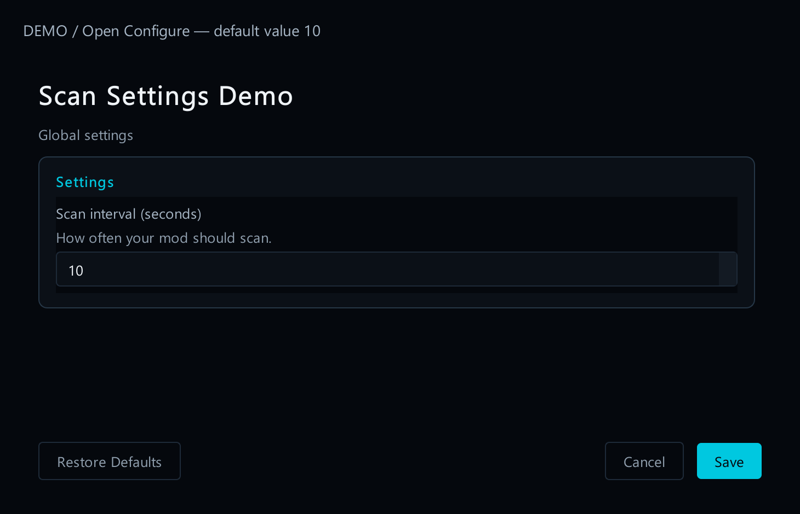
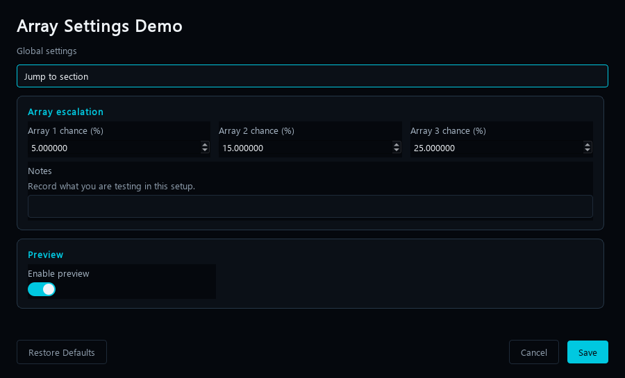
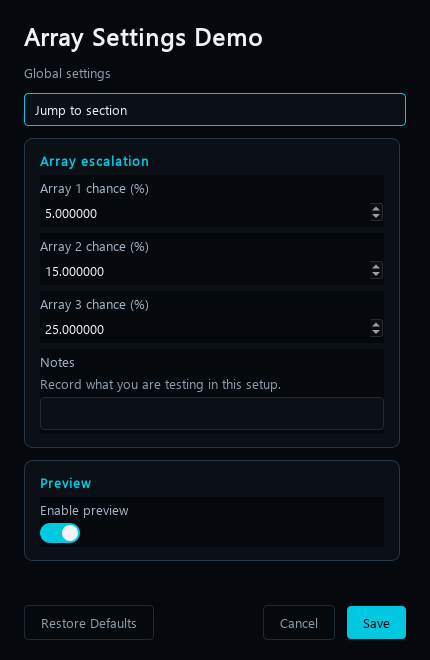

# 3a. Design Configure forms

[Start here](00-start-here.md)

## Keep related settings together

The launcher builds the **Configure** form from your manifest. Give related fields the same group heading and list them together in the order players will use them. Use short labels with units and brief descriptions that explain the effect of changing a value.

Mark rarely used settings as advanced. Players can reveal them with **Show advanced settings**. Forms with at least eight fields also show a search box. Compact controls can share a row. Wider controls get their own row, and rows wrap to fit the form.



[Open full-size image](images/configure-default.png)

*Existing demo using the launcher’s settings window.*

See [Choose form controls](04-controls.md) for the available input types and [Translate setting labels](06-languages.md) for localized headings and help text.

## Try three percentage settings

Use the settings example below as the value of `settings` in a schema-3 `evejs-launcher.mod.json`. The example puts three escalation chances in the same group. Each field accepts a percentage from 0 to 100, with a step of 0.5 and a separate key in `preferences.json`.

In a disposable mod, open **Configure** and look for all three values under **Array escalation**. Change Array 2 to 17.5 using your locale’s decimal separator, save, and reopen the form. The file should store 17.5 at `escalation.array2ChancePct`. Try another edit and cancel to confirm the saved value stays put. Your mod reads the file to apply the values.

## Layout overrides

Add `evejs-launcher.settings-layout.json` beside the manifest to arrange existing field IDs. Sections appear in file order. Two or three IDs can share a row when space permits. One ID requests the full width. Unlisted fields keep their automatic layout.

Find `configure-layout-demo` in [Example files](15-example-files.md). The three percentage fields share a row at suitable widths. Notes has its own row. Resize the form to see the layout adapt. Earlier launchers read the same settings manifest and use their standard layout. Invalid or outdated layout hints show a notice and fall back to automatic layout.



[Open full-size image](images/configure-layout-wide.png)



[Open full-size image](images/configure-layout-narrow.png)

---

## Code examples

```json
{
  "schemaVersion": 1,
  "files": [
    {
      "id": "prefs",
      "base": "mod",
      "path": "preferences.json",
      "format": "json"
    }
  ],
  "fields": [
    {
      "id": "array1Chance",
      "label": "Array 1 escalation chance (%)",
      "group": "Array escalation",
      "type": "number",
      "default": 5,
      "minimum": 0,
      "maximum": 100,
      "step": 0.5,
      "file": "prefs",
      "key": [
        "escalation",
        "array1ChancePct"
      ]
    },
    {
      "id": "array2Chance",
      "label": "Array 2 escalation chance (%)",
      "group": "Array escalation",
      "type": "number",
      "default": 15,
      "minimum": 0,
      "maximum": 100,
      "step": 0.5,
      "file": "prefs",
      "key": [
        "escalation",
        "array2ChancePct"
      ]
    },
    {
      "id": "array3Chance",
      "label": "Array 3 escalation chance (%)",
      "group": "Array escalation",
      "type": "number",
      "default": 25,
      "minimum": 0,
      "maximum": 100,
      "step": 0.5,
      "file": "prefs",
      "key": [
        "escalation",
        "array3ChancePct"
      ]
    }
  ]
}
```

### Layout file for the three-percentage example

```json
{
  "schemaVersion": 1,
  "sections": [
    {
      "id": "arrayEscalation",
      "title": {
        "en": "Array escalation",
        "nl": "Escalatie van arrays"
      },
      "rows": [
        [
          "array1Chance",
          "array2Chance",
          "array3Chance"
        ]
      ]
    }
  ]
}
```
