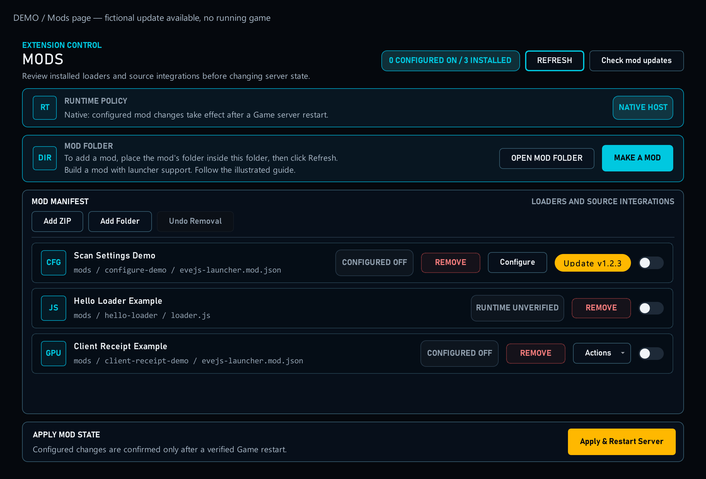

# 18. Keep mods working through EveJS updates

[Start here](00-start-here.md)

Launcher 1.0.74 adds update support for every mod author. In Native mode, refreshing Mods protects valid installed mod folders, including disabled mods, and server configuration files declared through settings schema 1. Store durable state in the resolved data root, normally `_local/<your-mod-id>/`. Open the launcher and finish refreshing before using the bundled EveJS updater in place.

An enabled Native loader or JSON-activated source mod can opt into `prepare_server_start`. Declare Launcher 1.0.74 as the minimum version. Its helper runs before Game or Market starts, using the normal request/result API without a client profile. Healthy checks must avoid writes; real source repairs must verify stopped services, reviewed bytes and owned backups. Unknown edits or a failed helper stop startup. This action does not run for Docker.

Version declarations are advisory: users can try an unlisted EveJS release with Run anyway. Actual helper failures and source guards still apply. No launcher code change or author registration is needed.

[Open full-size image](images/mods-overview.png)

---

## Code examples

[Upgrade contract](reference/evejs-upgrades.md) · [Runnable example](../../examples/mods/native-startup-demo/README.md) · [Helper source](../../examples/mods/native-startup-demo/helper.js)
