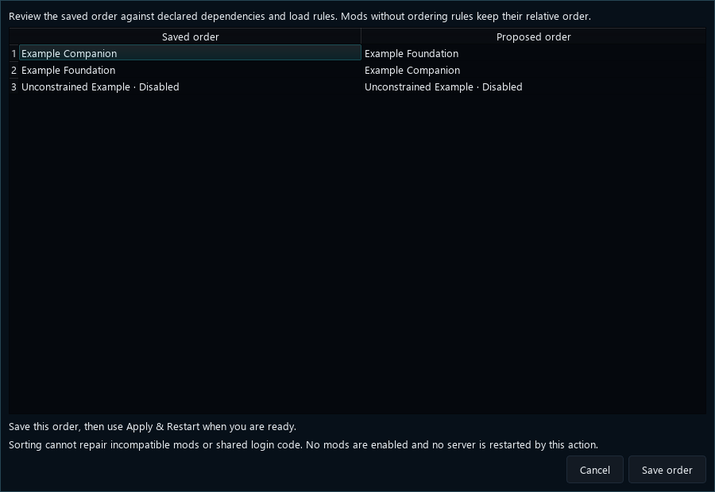

# 19. Portable Docker mods and safe ordering

[Start here](00-start-here.md)

Launcher 1.0.80 lets authors declare Linux server helpers, Windows client preparation and verified image contributions. A Node loader can be portable; a Windows installer or binary needs a real Docker port. Adding Docker to a support list does not convert it. Use the portable helper example and technical contract below. Keep durable mod data in the supplied persistent data root. Connect-only mode observes the stack without running maintenance.

**Sort by dependencies** previews saved and proposed order from declared requirements and load rules. Review the preview, then choose **Save order**. Mods without rules keep their relative order. Disabled mods stay disabled; saving does not restart Game. Missing requirements, conflicts, cycles or a changed installation prevent saving. Sorting cannot repair incompatible mods or shared login code. The image uses fictional mods in the actual preview dialog.

Shared login delivery composes compatible client initializers without replacing native authentication. An OK receipt only proves the initializer returned; UI, RPC and HUD readiness need a separate acknowledgement. Reconnect, rollback and both runtimes require their own tests.

[Open full-size image](images/dependency-sort-preview.png)

---

## Code examples

[Docker contract](reference/portable-docker.md) · [Helper example](../../examples/mods/portable-helper-demo/README.md) · [Manifest](../../examples/mods/portable-helper-demo/evejs-launcher.mod.json) · [Helper](../../examples/mods/portable-helper-demo/helper.cjs)
